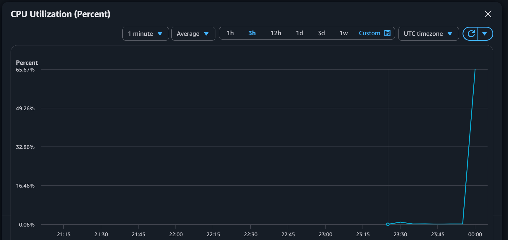
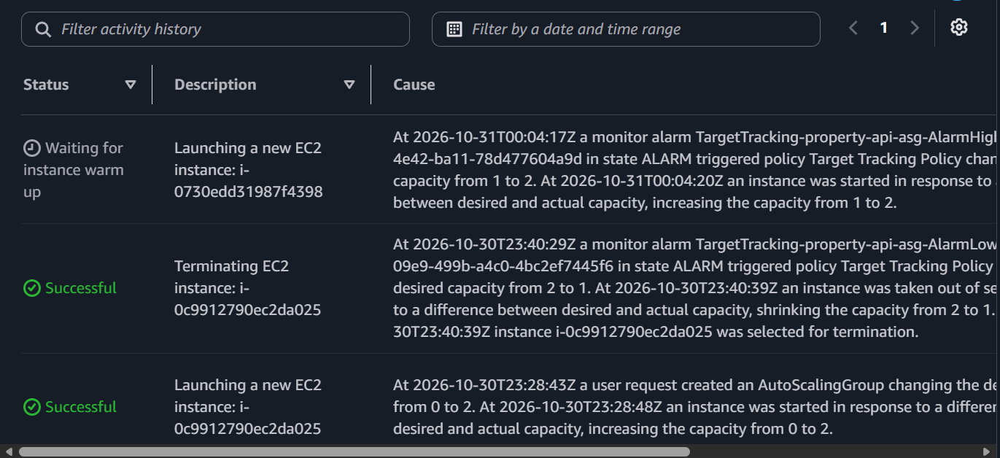

# Week 6: Load Test Report

## Setup

PropertyLite running on an Auto Scaling Group behind an Application Load Balancer in `training-vpc`.

- ASG `property-api-asg`: desired/min/max = 2/1/4, instances in the two private subnets
- Launch template `property-api-template`: Amazon Linux 2023, t3.micro, user data bootstraps the Flask app on port 8080
- ALB `property-alb`: internet-facing, HTTP:80 forwarding to target group `property-api-tg` (port 8080, health check `/health`)
- Scaling policy: target tracking on average CPU utilization, target 50%
- Health checks: ELB type, 300 second grace period

## Test

Ran `stress-ng --cpu 2 --timeout 600` on <FILL IN: both instances / one instance> through the bastion host. Load started at about 23:55 UTC on 2026-10-30.

## Results

All times UTC.

| Event                                | Time            |
| ------------------------------------ | --------------- |
| Stress test started                  | ~23:55          |
| CPU average first above 50%          | 23:57           |
| CPU peak                             | 65.67% (~00:00) |
| `AlarmHigh` entered ALARM            | 00:04:17        |
| Scale-out launched (capacity 1 to 2) | 00:04:20        |
| **Gap: CPU above 50% to scale-out**  | **~7 min**      |

Note: <FILL IN after hovering the datapoints: whether 23:57 is a real datapoint or interpolated between 5-minute points. If interpolated, the gap from the first real datapoint above 50% is about 4 minutes.>

Earlier in the session the ASG also scaled in: `AlarmLow` fired at 23:40:29 and capacity dropped from 2 to 1.

## Observations

- **Why the gap exists:** a target tracking alarm does not fire on a single reading. CloudWatch has to see several consecutive datapoints above the target, and EC2 basic monitoring publishes a datapoint only every 5 minutes, so the alarm lags the real load by a few minutes.
- **Warmup:** the new instance showed "Waiting for instance warm up" after launch. During warmup its metrics are left out of the group average, which stops the ASG from adding more capacity before the new instance is actually doing work.
- **Scale-out is faster than scale-in:** `AlarmHigh` needs only a few datapoints above 50%, while `AlarmLow` needs 15 consecutive datapoints below 35%. Target tracking is deliberately quick to add capacity and slow to remove it.

## What went wrong

- Used `https://` against the ALB. Only an HTTP:80 listener exists, so the request hung. Fix: use `http://`.
- ALB, target group, and some security groups were created in the default VPC instead of `training-vpc`. Resources cannot be moved between VPCs, and security groups in different VPCs cannot reference each other. Fix: tore everything down and rebuilt with VPC checked on every create screen.
- SSH to the private instances was blocked. The security group needed a port 22 rule sourced from the bastion's security group, and the launch template needed a key pair, which cannot be added to a running instance. Fix: added the rule and a new template version with `training-key`, then replaced the instances.
- `Permission denied (publickey)` on the second SSH hop. Fix: use ssh-add ~/.ssh/training-key.pem then ssh-add -l to make sure the traing-key are properly forward.
